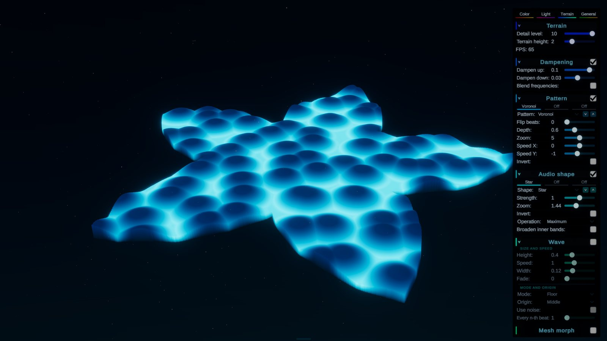
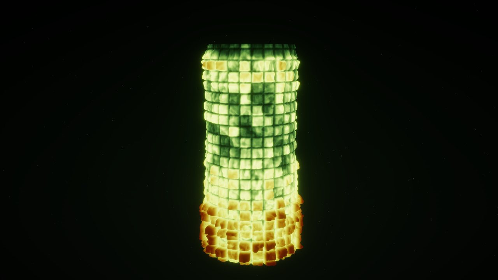
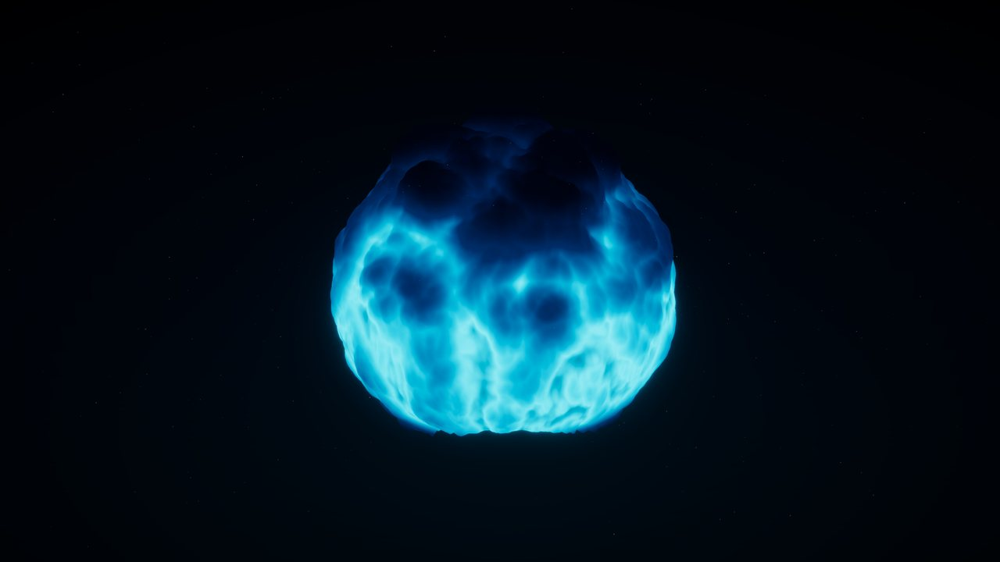
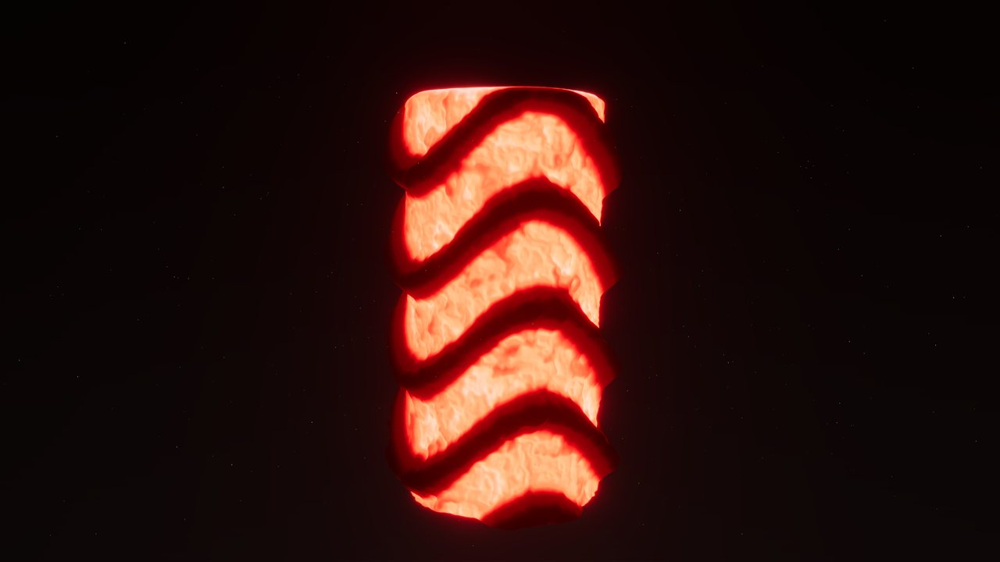
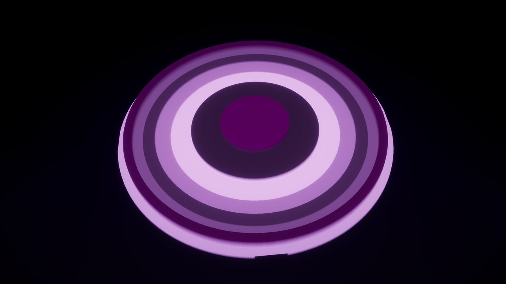
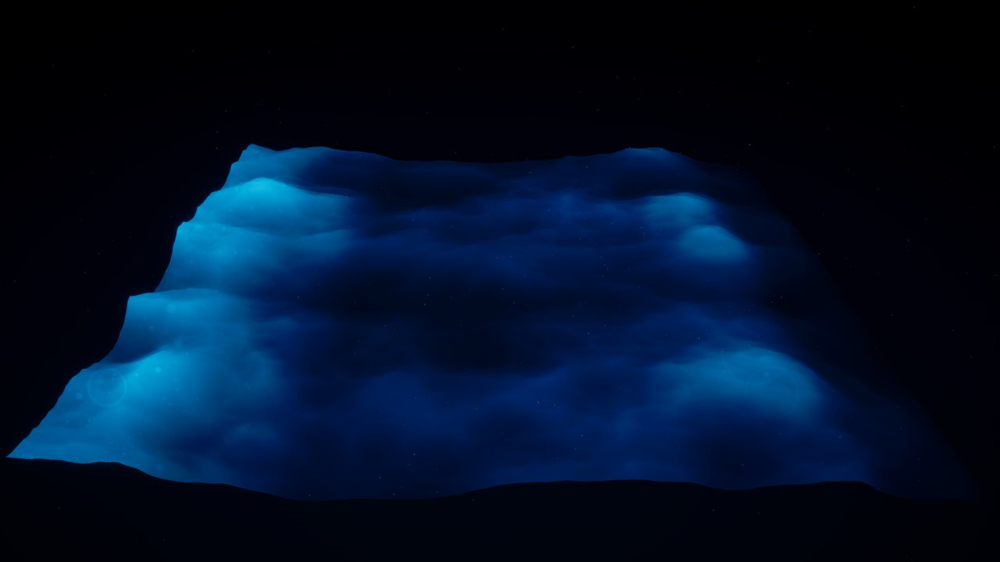
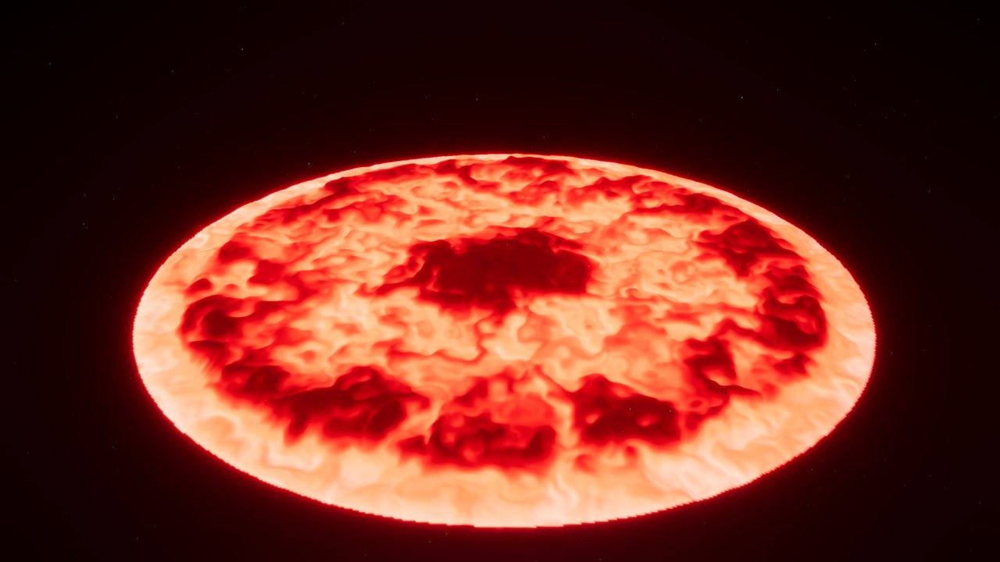

# Audio Visualization

**Status:** Standby  |  **Built:** 2017 to 2019, reworked 2026  |  **Role:** Solo developer

A sandbox music visualizer for Unity: a glowing terrain that is shaped by the song that plays. Bass, mids and highs push
the mesh up, a noise pattern keeps it moving, waves run over it on the beat, and everything can be tuned live in a slide-in menu
with dozens of sliders.

https://github.com/user-attachments/assets/d5fe2874-6a72-4647-bc8e-21bc63c1d96f

The longer demo is on YouTube: [Audio Visualization, hero video](https://www.youtube.com/watch?v=qF42xZbG59Q)

**Try it:** [Download the game](https://github.com/BrokkoliBoy/Audio-Visualization/releases/latest) (Windows), unzip it and start
`Audio Visualization.exe`. The app runs on all monitors, but it is optimized for HDR monitors (use Shift + Win + Left / Right
arrow to move the window to another monitor).

## What you can do here

There is no goal, no score and nothing to win. Put on a song (or the microphone), open the menu and play: pick a noise pattern,
choose which part of the spectrum shapes which part of the terrain, send waves over it on the beat, bend the whole mesh into a
planet, or play with its colors. Think of it as an instrument for pictures or videos. When you find a look you like, save it as a preset
and come back to it. If you only want to watch, lean back and let a song run.

## Why I built this

This started as a side quest: I wanted a wall in a different project to move along with whatever song was playing. I quickly
realized the same idea could drive all kinds of visuals, so I split it off into its own project and just had fun seeing what I
could build with it. It became a nice outlet for creativity beyond "does the gameplay work", and it still is.

I built it mainly for myself, so it is shaped by what I like to look at. It is online for anyone who wants to look or play
along, without the claim that it suits everybody. Yet I am planning to make it more accessible for a wider audience than just
me.

## How it was built

The first version of the project (2017 to 2019) is mine alone: the audio sampling, a small module pipeline for routing
audio data into object properties, and the first visual scenes. In autumn 2026 I picked the project up again and turned it
into the visualizer you see here, and from that point on I build it with Claude Code. I decided to keep vibe-coding this
project instead of programming it myself, because it is about creativity, not about technical craft.

In this team of two I am the art director and Claude Code is the development team. I decide what the project should be and how
it should look and feel, I test every change by eye and ear, and I do the fine tuning that gives it its character. Claude Code
writes the code. That is why there are so many sliders: I see room for fine tuning in each one, for every preset, and I know
what it does and when it matters.

## Features

- **Spectrum terrain.** Frequency bands, bass first, are mapped onto up to three overlapping *audio shapes* (circle, stripes,
  rays, spiral, star, rings and more), each with its own strength, zoom and blend mode.
- **32 noise patterns** (Perlin, Domain warp, Voronoi, Hexagons, Plasma, ...), up to three mixed into one terrain, each with
  depth, speed and zoom.
- **Beat waves.** Rings run over the terrain in time with the song's BPM and grow when the bass is strong, so quiet passages
  stay quiet.
- **Mesh morph.** Bends the whole mesh into a planet, tube, pillar, dome, pringle, twist or flag.
- **Color and light.** HDR palettes (save your own), bloom, lens dirt that pulses on the beat, and a background that takes the
  hue of the terrain.
- **Test signal.** Replaces the song with a calm, fixed spectrum, so an effect can be judged without a moving song. A band
  editor lets you raise and lower single bands with the mouse.
- **Music.** Four free-to-use songs, a 20 to 20,000 Hz test sweep and live microphone input, cycled from the player bar or with
  the arrow keys.
- **Presets.** Every setting can be saved, loaded and sent to someone else as text. Eight ship with the build (see below).

| Jungle | Thunderstorm |
|---|---|
|  |  |
| **Zerg** | **Spacewarp** |
|  |  |
| **Ocean** | **Lava River** |
|  |  |

## Controls

Everything can be done with the mouse. The menu on the right opens when the pointer touches the right edge, the player bar
opens at the bottom. The keyboard shortcuts:

| Key | Action |
|---|---|
| Left / Right | Previous / next song |
| Up / Down | Volume (hold) |
| Space or P | Pause and resume (the picture stays) |
| R | Restart the song |
| Tab | Show or hide the terrain menu |
| M or Esc | Show or hide the small menu next to the player bar (HDR output, quit) |
| T | Test signal on / off |
| Left drag | Orbit the camera (on the terrain: turn the terrain) |
| Right drag | Move the camera |
| Mouse wheel | Zoom (on a slider: change the value, Shift = 5x steps) |
| W A S D, Q E | Fly the camera |
| C | Reset camera and terrain turn |

## Under the hood

**Rendering.** Unity 6.6 with the High Definition Render Pipeline (HDRP). The HDR colors, bloom, vignette and the tinted sky all
run through its volume system, so the project does not open as is in a URP or Built-in project.

**Audio.** FFT bins from Unity's spectrum sampler are folded into logarithmic frequency bands. Every song carries its own BPM
and beat offset, and beats are also detected from the bass. The spectrum and the beat timing still come through the original
module pipeline from 2017 to 2019, see [docs/architecture.md](docs/architecture.md).

**Burst jobs.** Heights, colors, waves, morph and noise run as Burst jobs on all cores. The mesh update at 115 x 115 faces went
from 13.6 ms to 0.7 ms. Max FPS, Efficiency and the face count are in the menu, with a green-to-red background that shows what
each one costs.

**Data-driven.** Presets and palettes are small JSON files in `StreamingAssets`; new ones go to the user's data folder.

## Where it stands

The visualizer is in a very finished state and is on standby for now. I can pick it up again whenever I feel like it, and the
likely next steps are polish on the menu and the user experience, and new views. The ideas list is in
[docs/features.md](docs/features.md).

Only this terrain is part of the build. The project also holds other scenes, some from before the rework, that are switched off
and not shipped.

## Credits

Four songs used in this project are free-to-use releases from [NCS (NoCopyrightSounds)](https://ncs.io/):

- Song: DEAF KEV - Invincible [NCS Release] · Music provided by NoCopyrightSounds · Free Download/Stream: http://ncs.io/invincible · Watch: http://youtu.be/J2X5mJ3HDYE
- Song: Lynxie, johnny joined - i still hear your voice · Music provided by NoCopyrightSounds · Free Download/Stream: http://ncs.io/istillhearyourvoice · Watch: http://ncs.lnk.to/istillhearyourvoiceAT/youtube
- Song: L3VI - in motion · Music provided by NoCopyrightSounds · Free Download/Stream: http://ncs.io/inmotion · Watch: https://ncs.lnk.to/inmotionAT/youtube
- Song: SILVER BULLET - Nobody Else · Music provided by NoCopyrightSounds · Free Download/Stream: http://ncs.io/S_NobodyElse · Watch: https://ncs.lnk.to/S_NobodyElseAT/youtube

## License

The source code is under the [MIT license](LICENSE). This does not cover the four songs above or third-party packages, which stay
under their own licenses.
